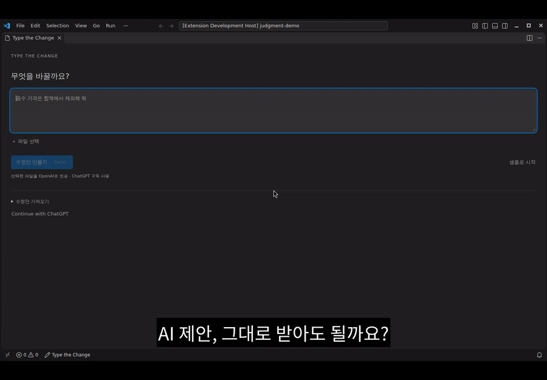

# Type the Change

**Codex가 바꾼 코드에서, 한 가지씩 이해합니다.**

작업을 고르면 왜 바뀌었는지에 대한 설명과 핵심 코드를 바로 보여줍니다. 퀴즈를 풀거나 긴 대화·파일 목록을 읽을 필요가 없습니다.

## 시작하기

1. 오른쪽 **Type the Change**를 열고 학습할 작업을 고르세요. 현재 프로젝트의 최근 작업 5개부터 표시합니다.
2. 기존 설명과 코드를 바로 읽습니다. 필요하면 **이전 코드**를 펼칩니다.
3. **변경 비교**는 편집기의 원본 비교를, **Codex에서 열기**는 원래 채팅을 엽니다.
4. 추가 설명이 필요할 때만 **⋯ → 이 채팅에 코드 설명 부탁하기…**를 고릅니다. 요청 내용을 확인한 뒤 **이 채팅에 보내기**를 눌러야 전송됩니다. 닫으면 보내지 않습니다.

카드는 원래 Codex 채팅에 남습니다. TTC는 카드의 코드가 같은 채팅의 실제 수정 기록과 일치하는지 확인한 뒤 표시합니다. 기존 설명은 정확한 파일 경로를 명시하고, 같은 작업 단계에서 해당 수정 바로 앞에 있으며, 프로젝트 워크트리에서 확인될 때만 수정 맥락으로 표시합니다. 가까이 있다는 이유만으로 설명을 붙이지 않습니다.

**에이전트·대화·기억·작업은 Codex가 관리합니다.** TTC는 모델을 직접 호출하거나 별도 에이전트를 시작하지 않습니다. 사용자가 요청 내용을 확인하고 전송할 때만 원래 Codex에 설명을 요청하며 모델·권한은 Codex의 기존 설정을 따릅니다. 표시할 설명은 잠시 메모리에만 보관합니다.

[설치](https://marketplace.visualstudio.com/items?itemName=CodeNyangi.type-the-change) · [English](README.md)

[사용법](docs/guide.ko.md) · [검증](docs/verification-0.8.1.md) · [개인정보](PRIVACY.md) · [MIT](LICENSE)

[이전 사용법 영상](assets/type-the-change-quickstart.mp4) · 선택 기능인 수정안 가져오기·직접 수정·검사 흐름의 이전 화면입니다. 현재 기본 화면은 변경 설명과 핵심 코드입니다.

미리보기 · VS Code 1.106+ · 신뢰한 로컬 프로젝트 · 설치된 Codex 필요. 한국어·영어와 위치 변경은 **설정**에서 고릅니다. 이전 수정안·MCP 기능은 명령 팔레트에 남아 있습니다.
