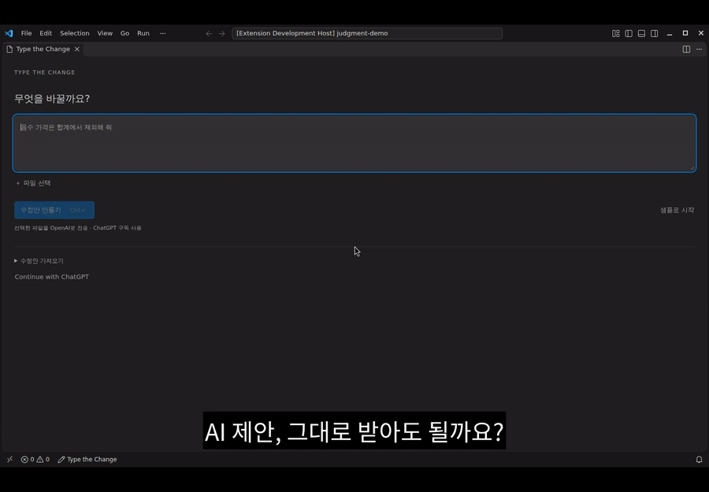

# Type the Change


**AI suggests. You predict, check, and decide.**

[한국어](README.ko.md) · [VS Code Marketplace](https://marketplace.visualstudio.com/items?itemName=CodeNyangi.type-the-change) · [Download VSIX](https://github.com/CodeNyangi/type-the-change/releases) · [Report an issue](https://github.com/CodeNyangi/type-the-change/issues/new/choose) · [Contribution policy](CONTRIBUTING.md)

A small, open-source VS Code extension for practicing judgment while coding with AI. Keep your own editor, inspect a proposed change, and decide whether the actual code deserves to stay. Exact text matching never approves a change.

[](assets/type-the-change-quickstart.mp4)

**[Watch the walkthrough →](assets/type-the-change-quickstart.mp4)** · [Try the same example](examples/judgment/README.md)

The captioned video uses real VS Code, a deliberately wrong local proposal, and a real test run. It shows why `break` still loses a price, then keeps the author's `continue` alternative. No live AI account is needed.

1. **Predict.** Write one short expected result before revealing the suggestion.
2. **Check.** Edit normally, save and run a selected check with a shortcut, then inspect the actual diff.
3. **Decide.** Record the evidence and keep your change, reject the proposal, or defer.

The guide stays beside your code in the same VS Code window. You can keep a different implementation within the guided range. If code changes after comparison, previous evidence no longer approves it. If your alternative invalidates a later planned step, the guide asks for a new plan.

These are your judgments, not an automatic correctness grade. **Save and Check** saves only files in the current review and runs the VS Code task you selected. The extension does not apply a proposal or undo a rejected edit. Learning and better judgment are design goals; learning gains have not been measured.

## Start in a minute

Requires local desktop VS Code 1.100+. This is a preview, currently with a Korean interface.

1. Install **Type the Change** by **CodeNyangi** from the [VS Code Marketplace](https://marketplace.visualstudio.com/items?itemName=CodeNyangi.type-the-change). For a downloaded GitHub VSIX, use **Extensions: Install from VSIX…**.
2. Run **Type the Change: Try the Demo**. Predict the total of `[10, -5, 20]`.
3. Submit the prediction with **⌘Enter / Ctrl+Enter**. Edit, then press **⌘⌥Enter / Ctrl+Alt+Enter** to save and check.
4. Compare the result with your expectation and write one reason. **⌘Enter / Ctrl+Enter** moves to the decision buttons; **← →** selects and **Enter** records your decision.

Submitting the prediction reveals the proposal and returns focus to your code. **⌘⌥T / Ctrl+Alt+T** returns to the change. Continuing never automatically accepts it. **×** ends guidance and preserves edits.

For a real project, choose an existing foreground **VS Code task** once. The picker describes and applies `task.saveBeforeRun: never` so VS Code does not silently save unrelated dirty editors. This changes the workspace task preference (or the user preference if no folder is open); cancel or choose comparison to leave it unchanged. Later checks reuse it; a changed task definition requires selection again. **검사 옵션** lets you change tasks or compare without running one. The latter never saves files. Task progress, exit status, and available problem-matcher diagnostics appear beside the code. Tasks without a process exit remain **unverified**, not passed. Editing a reviewed file during or after execution invalidates that result. Checks run through VS Code's normal task system, including the task's own behavior and dependencies; no command comes from the AI plan.

For the video's deliberately wrong proposal, open [`examples/judgment`](examples/judgment/README.md) as a folder and import `plan.json`. Its check task is included. Demo and imported plans work offline without sign-in.

**Preview:** 0.4.0 adds the keyboard and task workflow. Real-account ChatGPT consent and subscription-backed generation remain unverified.

## Working in a large repository

Choose the change and checks relevant to one decision. File selection starts with open files and existing Git changes. A typed query searches at most 200 matching paths using VS Code's normal exclusions; selected paths remain pinned across queries. Refine a broad query to reach another file. Opening the picker never requests the entire file list.

A generation request is still limited to eight files, each at most 64 KiB. Total repository size is separate from the reviewed context. This preview does not provide whole-repository impact analysis, giant-file support, or automatic test selection. Choose a module's task locally and keep full regression checks in your project's CI.

## AI-assisted coding with ChatGPT

Run **Type the Change: Start**, describe your intent in the panel, select up to eight source files, and choose **수정안 만들기** (or ⌘Enter / Ctrl+Enter). For example: “Exclude negative prices from the total, and explain the condition I should inspect.” The first request opens **Continue with ChatGPT** in your browser for account consent. The extension uses your remembered model, or the first model in the provider-ordered available list. Use the model button to change it.

This uses OpenAI's official [Sign in with ChatGPT for open-source apps](https://developers.openai.com/siwc/token-sharing-open-source/sign-in), with your account's eligible plan access and limits. An API key is not required. It is not unlimited or an assurance that every subscription is eligible. Requests display that they consume ChatGPT plan usage; usage can be managed in [ChatGPT settings](https://chatgpt.com/settings/usage).

Only the explicitly selected file contents and your request are sent for plan generation. Tokens live in VS Code SecretStorage. The extension does not read another application's credentials. It uses PKCE, a loopback callback, signed ID-token validation, rotating refresh tokens, and revocation on sign-out. Read the [privacy policy](PRIVACY.md) for data handling.

## MCP server for typing plans

Run **Type the Change: Show MCP Connection** in your workspace to get the exact configuration for the installed extension. The bundled stdio server requires **Node.js 22+** on your PATH.

```json
{
  "mcpServers": {
    "type-the-change": {
      "command": "node",
      "args": ["/absolute/path/to/dist/mcp-server.cjs", "--workspace", "/absolute/path/to/project"]
    }
  }
}
```

The server exposes three tools:

| Tool | Purpose |
| --- | --- |
| `read_file` | Read a bounded, existing UTF-8 source file in the configured workspace. |
| `propose_typing_plan` | Validate exact replacements and write a local plan for the extension. |
| `get_typing_status` | Read the extension's most recent dated progress snapshot. |

Ask your client: “Read the relevant file, propose a small typing plan for this change, and let me implement it in VS Code.” Open the notification or run **Type the Change: Open MCP Plan**.

The MCP server makes no model requests and cannot modify source or run shell commands. Its client supplies the intelligence and uses that client's own authentication and billing. ChatGPT subscription access in this extension does not automatically connect arbitrary MCP clients.

Plans, dated progress, and the last session’s human decision notes are stored under `.type-the-change/`. Add that directory to the target project's `.gitignore`. Status is a last-known editor snapshot, not a fresh disk check or test result. `matched` describes text agreement. In 0.3.0, `complete` requires a recorded human keep decision; `rejected` and `deferred` are separate outcomes. The MCP status tool does not return your freeform prediction or evidence. Disconnect the server when you no longer want a client to read the configured workspace.

## Plan format

```json
{
  "version": 1,
  "title": "Ignore negative prices",
  "intent": "Exclude invalid negative prices from the total.",
  "steps": [{
    "file": "price.ts",
    "before": "    result += price;",
    "after": "    if (price >= 0) {\n      result += price;\n    }",
    "reason": "Only non-negative values contribute to the total."
  }]
}
```

See [the schema](plan.schema.json) and [a complete example](examples/plan.json). Each `before` must match exactly once in the state produced by preceding steps. Use an existing context anchor for insertion; an empty `after` deletes a range. Unknown fields, ambiguous anchors, protected paths, symlinks, and out-of-workspace files are rejected.

## Scope of this preview

- Existing local text files only; no new-file, rename, remote workspace, or binary plans.
- Exact text comparison, including whitespace. Edits outside the planned region pause acceptance. Files changed earlier in the plan are also checked.
- A 64 KiB file limit and up to 20 plan steps. Existing tasks run only after your explicit action; commands cannot come from the AI plan.
- One ChatGPT account binding per installation. Simultaneous authentication from multiple VS Code windows is not supported; use one window for connected requests.
- Session progress is in memory. Closing VS Code ends the guide; your normal editor save/restore behavior still applies. MCP plans remain on disk until removed or replaced.
- VS Code completion and format-on-type settings still apply; the extension does not disable your existing assistance or prove that every character was manually typed.

## Contributing

Community participation is through issues. Bug reports, root-cause analysis, feature proposals, and usability feedback are welcome in English or Korean. **External code contributions and pull requests are not accepted.** The repository owner handles implementation and human review.

- **Found a problem?** Search existing issues first, then [report it](https://github.com/CodeNyangi/type-the-change/issues/new/choose) with the VS Code/extension version, platform, reproduction steps, and expected versus actual behavior. Sanitized logs and technical analysis help.
- **Have a proposal or correction?** Describe the use case and desired behavior in an issue, including documentation corrections. See [CONTRIBUTING.md](CONTRIBUTING.md) for the issue-based participation policy.
- **Reporting a vulnerability?** Follow [SECURITY.md](SECURITY.md). Do not put tokens, private code, or real workspace plans in a public issue.

## Build and test from source

Use **Node.js 22+** and npm:

```sh
git clone https://github.com/CodeNyangi/type-the-change.git
cd type-the-change
npm ci
npm run check
npm test
npm run build
npm run test:host
npm run package
```

`test:host` runs the extension in an isolated VS Code profile and temporary workspace. On macOS it can use the installed VS Code; otherwise it downloads a pinned VS Code test build. Linux requires a display, for example `xvfb-run -a npm run test:host`. The VSIX is written to `artifacts/`.

For checks without opening a desktop window, install the isolated browser with `npx playwright install chromium --only-shell`, then run `npm run test:ui:webview`. Real workbench clicks run separately as `test:ui:vscode` on Linux CI with a virtual display; that script refuses local desktop launch. CI also checks the minimum VS Code version and Windows core behavior. See the [judgment workflow verification](docs/judgment-workflow-0.3.0.md) for results and limits.

Install that local VSIX with **Extensions: Install from VSIX…** to try the development build. If you investigate authentication or editor behavior, include relevant verification and its limits in your issue report.

Tests cover every webview command and state transition in a DOM environment, path boundaries, sequential plans, stdio MCP, OAuth state/PKCE/refresh/revocation, inference completion/cancellation, and real VS Code editor integration. Native typing tests use VS Code’s `type` command, including auto-pairs, indentation, CRLF, and deletion. A locked macOS host explicitly skips those keyboard cases; `TTC_REQUIRE_NATIVE_TYPING=1` and non-macOS runners require them. DOM tests do not verify browser pixels or real account consent.

`npm run preview` serves the exact production webview at http://127.0.0.1:8790 with a clearly labelled mock host. It can exercise narrow/light/dark/high-contrast layouts without signing in or sending code. It is a UI test fixture, not a substitute for editor or live-account tests. See [verification coverage](docs/verification.md).

The project draws on Sai's deliberate typing experience and the bounded tool interaction of the Unsecat MCP project.

[MIT license](LICENSE) · [Privacy](PRIVACY.md) · [Security](SECURITY.md) · [Bundled dependency notices](THIRD_PARTY_NOTICES)
